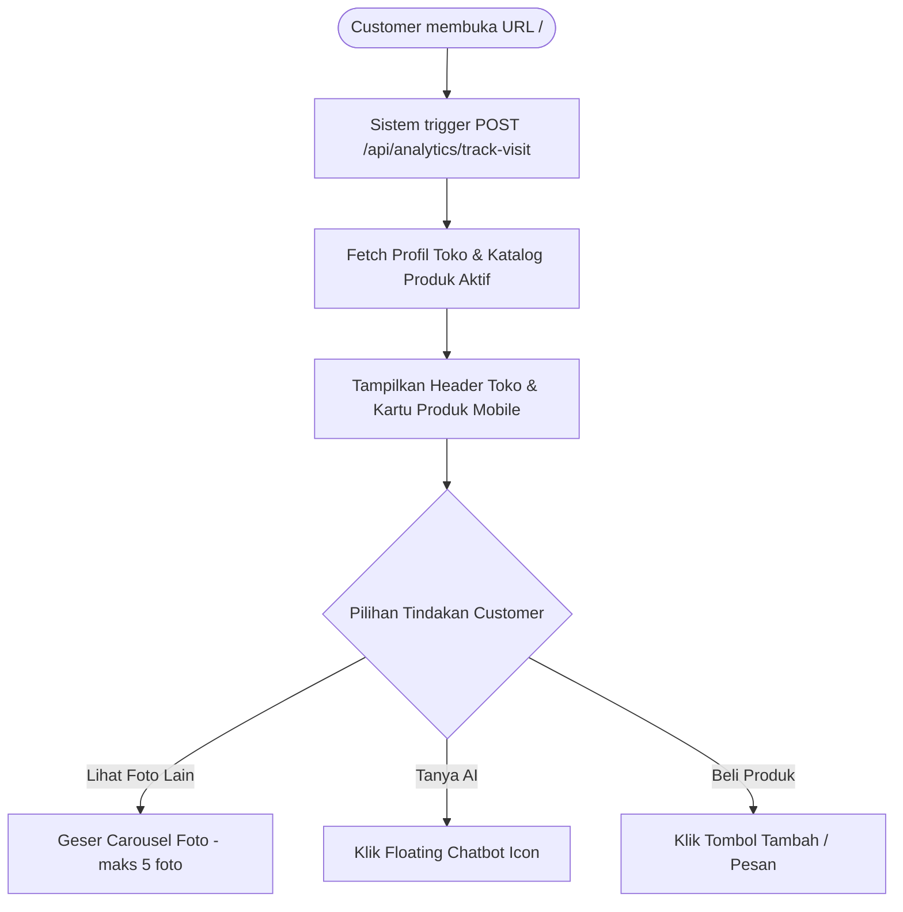
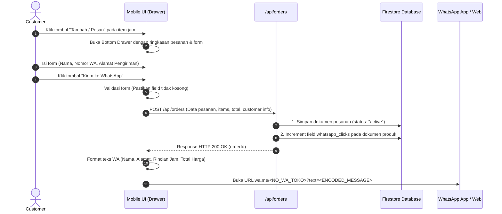
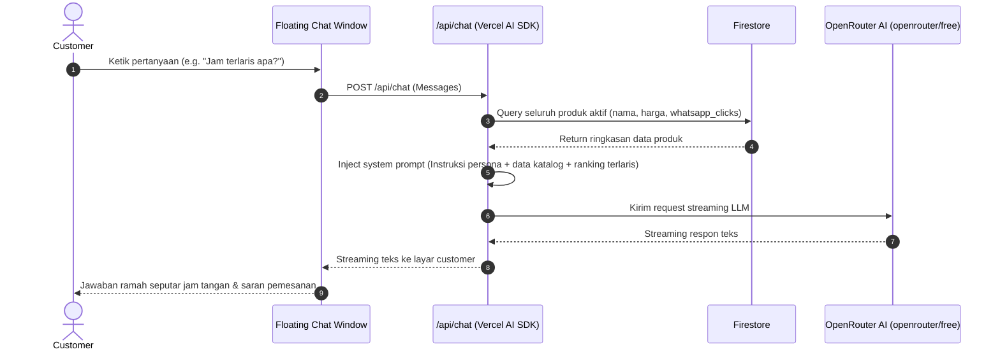
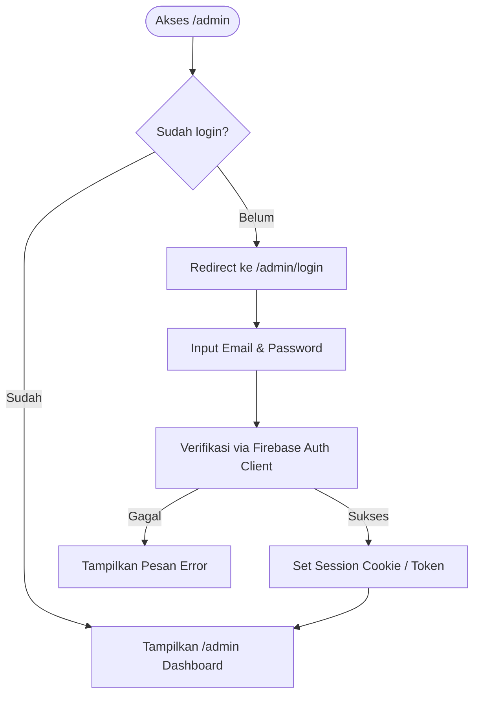
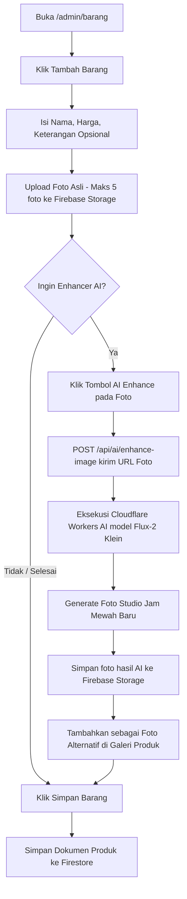

# Application Flow (APP_FLOW.md) — Sultan Arloji

Dokumen ini mendefinisikan seluruh alur pengguna (*user flow*), logika transisi halaman, dan interaksi sistem secara terperinci untuk **Sultan Arloji**.

---

## 1. Customer User Flows

### 1.1. Alur Eksplorasi Katalog & Kunjungan Toko

### 1.2. Alur Checkout WhatsApp & Pencatatan Pesanan

### 1.3. Alur Chatbot AI Customer (Konsultasi & Rekomendasi)

---

## 2. Admin User Flows

### 2.1. Alur Autentikasi Admin

### 2.2. Alur Pengaturan Data Toko & Nomor WhatsApp
1. Admin menavigasi ke tab **Toko** (`/admin/toko`).
2. Sistem memuat dokumen data toko dari Firestore (`stores/sultan-arloji`).
3. Admin dapat mengubah:
   - Logo / Foto Profil (upload gambar baru ke Firebase Storage).
   - Nama Toko.
   - Nomor WhatsApp Toko (nomor aktif yang menerima chat order).
   - Email / Password akun admin (memanggil fungsi update kredensial Firebase Auth).
4. Klik tombol **"Simpan Perubahan"**.
5. API Server Route memvalidasi sesi admin dan memperbarui data di Firestore.
6. Halaman customer langsung menggunakan nomor WhatsApp terbaru secara real-time.

### 2.3. Alur Tambah Produk & Peningkatan Foto AI (Cloudflare Workers AI)

### 2.4. Alur Manajemen Pesanan & History
1. Admin membuka tab **Pesanan** (`/admin/pesanan`).
2. Terlihat dua sub-tab: **Pesanan Masuk (Aktif)** dan **Riwayat (History)**.
3. Sub-tab **Pesanan Masuk (Aktif)**:
   - Menampilkan card pesanan dengan rincian: Tanggal/Jam, Nama Pemesan, Nomor WA, Alamat, Item Jam yang dipesan, dan Subtotal.
   - Admin memiliki tombol **"Tandai Selesai"**.
4. Saat tombol **"Tandai Selesai"** ditekan:
   - Frontend memanggil `PATCH /api/orders/[id]` dengan status `completed`.
   - Pesanan langsung berpindah dari daftar aktif ke sub-tab **Riwayat (History)**.
5. Sub-tab **Riwayat (History)**:
   - Menampilkan seluruh pesanan yang telah selesai dikerjakan untuk arsip pencatatan.

### 2.5. Alur Salin Link Toko
1. Pada header dashboard admin (`/admin`), terdapat widget tautan toko publik dan tombol **"Salin"**.
2. Saat diklik:
   - Mengambil URL origin (misal: `https://sultan-arloji.com/`).
   - Menyalin teks URL ke Clipboard menggunakan `navigator.clipboard.writeText()`.
   - Menampilkan toast notifikasi: *"Link toko berhasil disalin!"*.
   - Jika tombol share native ditekan, memicu `navigator.share()` bawaan smartphone.
